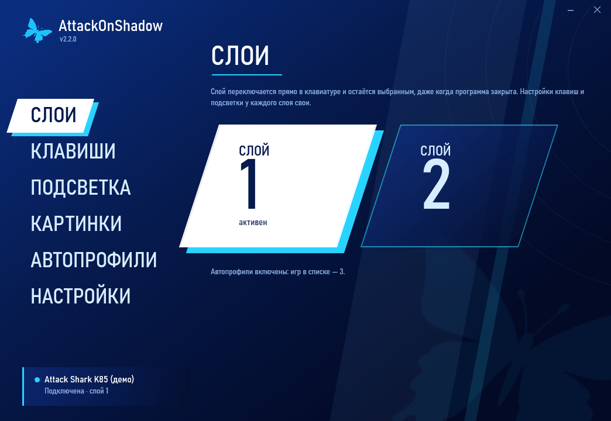
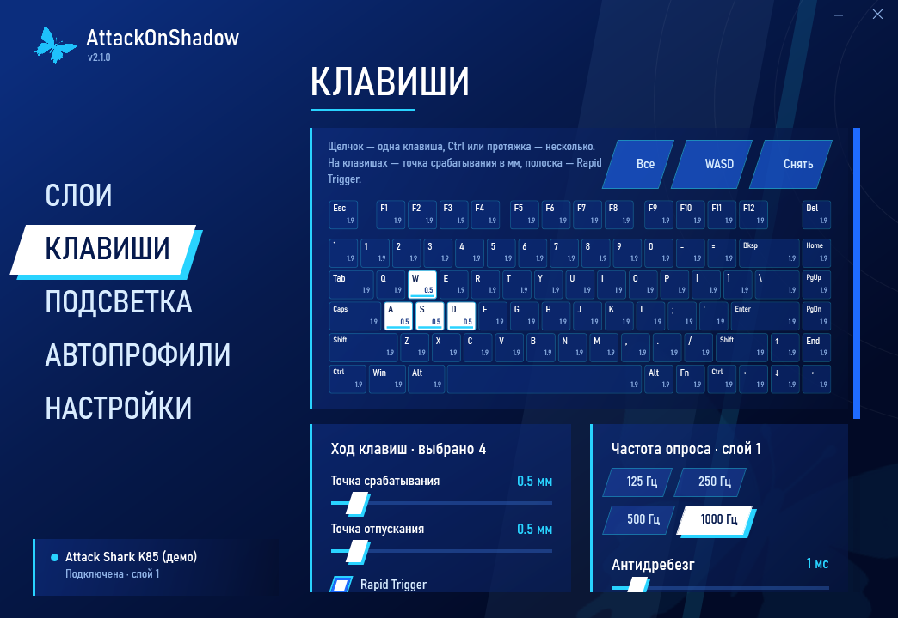
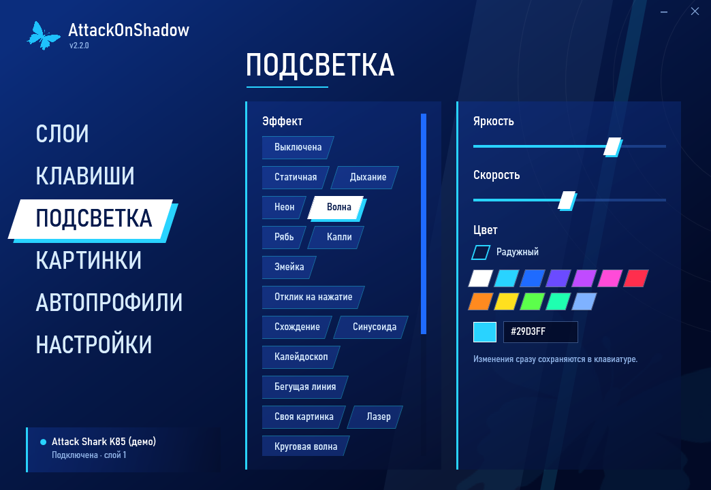
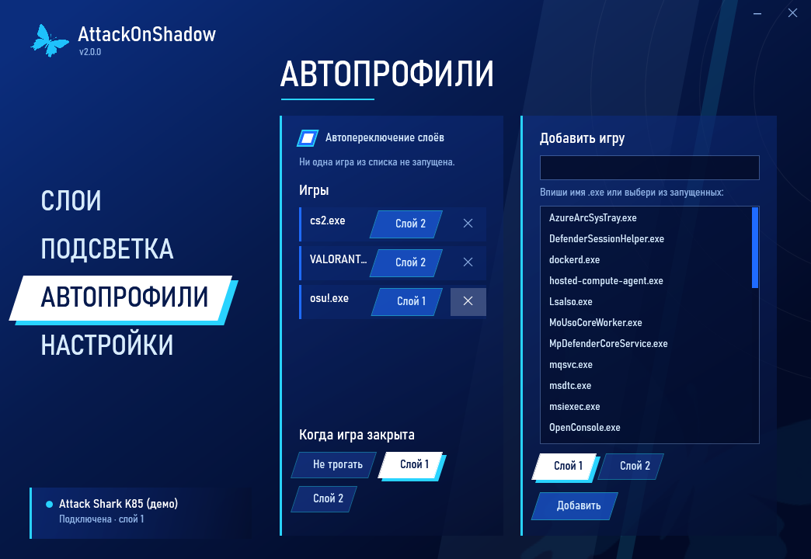

# AttackOnShadow

Приложение для клавиатуры **Attack Shark K85** в стиле Persona 3 Reload. Общается с клавиатурой напрямую по USB: официальный Attack Shark Driver не нужен.

## Что умеет

- **Слои.** Переключение двух слоёв клавиатуры. Слой хранится в самой K85 и остаётся выбранным, даже когда программа закрыта. Слой, переключённый на клавиатуре через Fn, программа тоже видит.
- **Клавиши.** Схема K85: точка срабатывания и отпускания, Rapid Trigger, нижняя мёртвая зона — для одной клавиши, группы или всех сразу. Пошаговая калибровка хода. Частота опроса (до 1000 Гц) и антидребезг.
- **Автопрофили.** Пока запущена игра из списка, клавиатура стоит на нужном слое. Когда игру закроешь, слой вернётся на «обычный» (или останется как есть — на выбор). Слой, выбранный руками, программа не перебивает.
- **Подсветка.** 19 эффектов, яркость, скорость, направление, свой цвет или радужный. Изменения сразу сохраняются в клавиатуре.
- **Трей.** Сворачивается в трей. Из меню трея можно переключить слой и включить или выключить автопрофили. При желании запускается вместе с Windows сразу в трей.
- **Обновления.** Раз в день программа проверяет релизы на GitHub и ставит новую версию сама, когда свёрнута в трей и игра не запущена.

## Установка

1. Скачай **AttackOnShadow.exe** со страницы [последнего релиза](https://github.com/SevereClaw/AttackOnShadow/releases/latest).
2. Запусти. Программа предложит установиться: скопируется в `%LOCALAPPDATA%\Programs\AttackOnShadow` и добавит ярлык в меню «Пуск». Можно и без установки, но тогда не будет автообновления на месте.
3. Подключи K85 по проводу.

Нужна Windows 10 или 11. Ставить ничего не надо: программа работает на встроенном .NET Framework 4.8 и весит около 250 КБ.

SmartScreen может предупредить о «неизвестном издателе», потому что файл не подписан. Нажми «Подробнее → Выполнить в любом случае». EXE собирается из этого репозитория в GitHub Actions, лог сборки открыт.

**Attack Shark Driver лучше закрыть.** Он тоже общается с клавиатурой, и команды двух программ могут перемешаться. Если в драйвере стоит старый мод AttackOnShadow, в «Настройках» есть кнопка, которая его удалит.

## Если что-то не работает

В «Настройках» включён журнал обмена с клавиатурой: программа записывает каждую команду и ответ в `%APPDATA%\AttackOnShadow\usb.txt`. Кнопка «Папка с журналами» открывает эту папку. Пришли `usb.txt` и `log.txt` — по ним видно, что ответила клавиатура.

Настройки хранятся в `%APPDATA%\AttackOnShadow\settings.json`. Правила автопрофилей из старого мода переносятся автоматически при первом запуске.

## Как это устроено

| Папка | Что там |
|---|---|
| `app/Hid` | Win32 HID: поиск интерфейса и feature-отчёты через `hid.dll` |
| `app/Device` | Протокол K85 (сборка и разбор пакетов, контрольные суммы), реальная и демо-клавиатура |
| `app/Services` | Настройки, автопрофили, автозапуск, установка, обновления |
| `app/Ui`, `*.xaml` | Окно на WPF и тема P3R |
| `docs/protocol-k85.md` | Описание USB-протокола K85 |
| `legacy/` | Прежняя версия: мод для Attack Shark Driver (v1.x) |

Протокол восстановлен по коду официального драйвера и сверен с открытыми реализациями того же протокола Rongyuan — подробности в [docs/protocol-k85.md](docs/protocol-k85.md).

Запуск для проверки без клавиатуры: `AttackOnShadow.exe --demo`.

## Выпуск новой версии

1. По желанию опиши, что нового, в `docs/release-notes/vX.Y.Z.md`.
2. Подними версию в файле `VERSION`, закоммить и запушь в `main`.

GitHub Actions соберёт приложение на Windows, прогонит самопроверку протокола, снимет скриншоты всех экранов на демо-клавиатуре (ветка `ci-screenshots`) и опубликует релиз с AttackOnShadow.exe. Коммит с `[skip release]` в сообщении только собирается и проверяется, без релиза.
