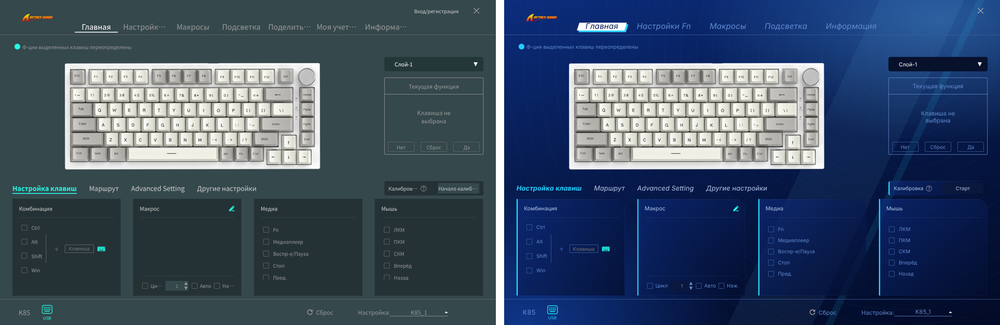
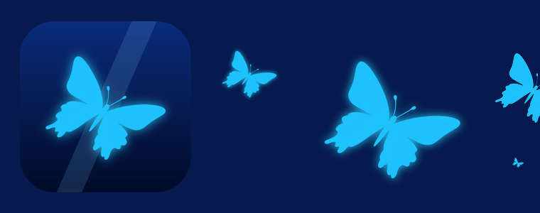
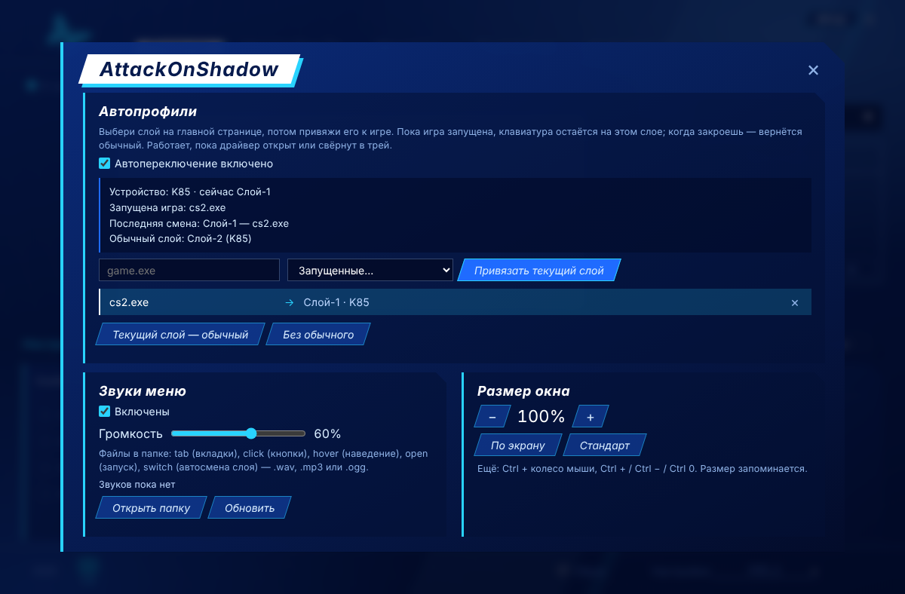
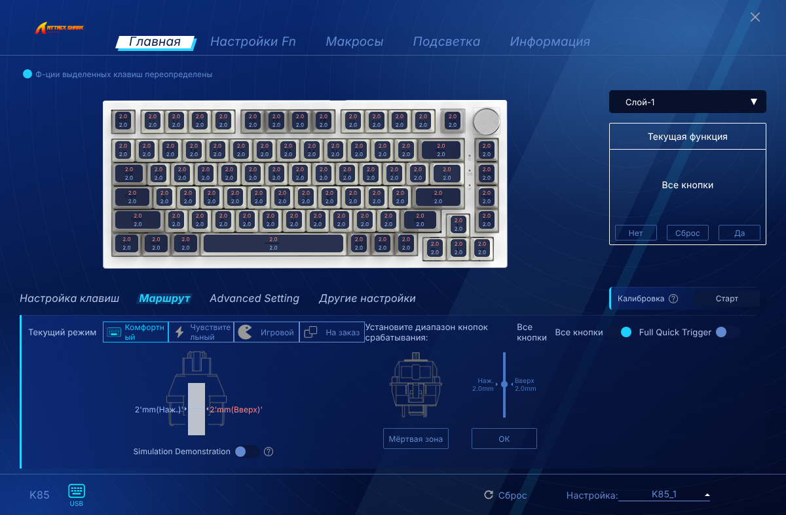
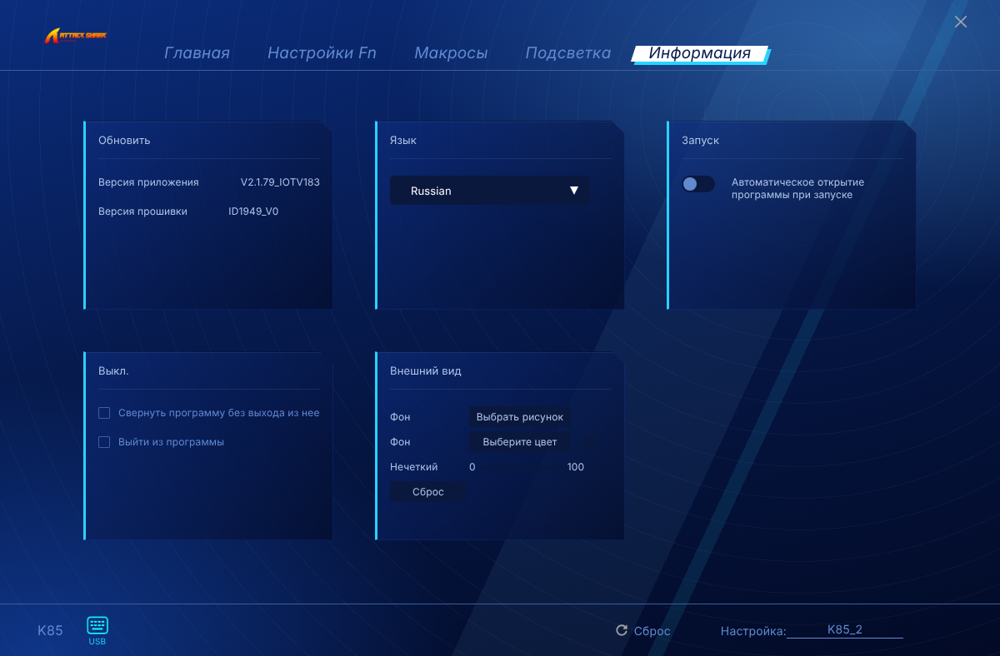

# AttackOnShadow

Мод для штатного **Attack Shark Driver** (проверен на версии 2.1.79): тема в стиле Persona 3 Reload, вырезанное облако и аналитика, починенные русские подписи.





## Что меняется

- **Тема P3R.** Тёмно-синий фон с диагональными бликами, белая скошенная плашка у активной вкладки, стеклянные панели со срезанным углом и голубой кромкой. Шрифт Bahnschrift (есть в Windows 10/11).
- **Бабочка вместо акулы.** Логотип в шапке и на экране поиска устройства, иконка окна и панели задач, иконка в трее. Значок самого `.exe` в проводнике и ярлыках остаётся прежним.
- **Свой фон работает.** P3R-фон стоит по умолчанию. Если выбрать в «Информация → Внешний вид» свою картинку или цвет, они применяются как есть; «Сброс» возвращает тему.
- **Без облака.** Вкладки «Поделиться», «Моя учётная запись» и кнопка «Вход/регистрация» убраны. Все сетевые запросы, кроме локального `127.0.0.1` (служба `iot_driver.exe`, которая общается с устройством по USB), блокируются.
- **Без аналитики.** Отправка экранов в Google Analytics отключена.
- **Без самообновления из сети.** Кнопки «Проверить обновления» и «Обновление прошивки» в офлайн-режиме скрыты. Заодно драйвер больше не может сам скачать и подменить `iot_driver.exe`.
- **Русские подписи.** Обрезанные строки укорочены («Калибровка», «Старт», «Мёртвая зона», «Не задано», «ОК»), непереведённые переведены («Расширенные», «Скорость», «Яркость», «Демонстрация»). Меню в трее сразу на русском.

### Панель «МОД» (кнопка в шапке)



- **Автопрофили.** Выбери слой на главной странице, впиши `.exe` игры (или выбери из запущенных) и нажми «Привязать текущий слой». Пока игра запущена, клавиатура остаётся на этом слое. Когда закроешь — вернётся «обычный» слой, если он задан. Переключаются встроенные слои самой клавиатуры, поэтому это мгновенно. Работает, пока драйвер открыт или свёрнут в трей (в «Информации» включи «Свернуть программу без выхода» и автозапуск).
- **Звуки меню.** Свои файлы `tab`, `click`, `hover`, `open`, `switch` (`.wav` / `.mp3` / `.ogg`) в папке `%APPDATA%\Attack Shark Driver\aos-sounds` (кнопка «Открыть папку»). Громкость и выключатель там же.
- **Размер окна.** От 60% до размера экрана: кнопки −/+, «По экрану», «Стандарт», а также Ctrl + колесо и Ctrl +/−/0. Размер запоминается.

- **Обновления мода.** Версия, «Проверить», «Обновить», автопроверка раз в день и автоустановка (только когда драйвер в трее и игра не запущена). Если есть новый релиз, на кнопке «МОД» загорается метка.

Настройки панели хранятся в `%APPDATA%\Attack Shark Driver\` (`aos-settings.json`, `aos-window.json`) и переживают переустановку мода.

Настройки клавиатуры и мыши (раскладка, макросы, подсветка, Rapid Trigger, DPI) работают как раньше: протокол устройства не трогается.




## Установка

1. Скачай **AttackOnShadow.exe** со страницы [последнего релиза](https://github.com/SevereClaw/AttackOnShadow/releases/latest) и запусти.
2. Он сам найдёт драйвер. Если не нашёл, нажми «Обзор…» и укажи `Attack Shark Driver.exe`. Потом нажми «Установить».
3. Запусти Attack Shark Driver как обычно (или кнопкой «Запустить драйвер»).

SmartScreen может предупредить о «неизвестном издателе»: файл не подписан. Нажми «Подробнее → Выполнить в любом случае». EXE собирается из этого репозитория в GitHub Actions (`setup/`), лог сборки открыт.

Без EXE: скачай репозиторий архивом и запусти `install.bat` (или перетащи на него `Attack Shark Driver.exe`).

Node.js ставить не нужно: патчер выполняется встроенным Electron самого драйвера (`ELECTRON_RUN_AS_NODE`). Права администратора нужны, только если драйвер стоит в `Program Files`.

После обновления драйвера с сайта Attack Shark запусти установщик ещё раз.

## Удаление

Кнопка «Удалить» в AttackOnShadow.exe или `uninstall.bat`: возвращает оригинальные файлы из бэкапа `resources\app\.aos-backup` байт в байт.

## Обновление

Само: раз в день мод проверяет релизы и ставит новую версию, когда драйвер свёрнут в трей и игра из автопрофилей не запущена. Драйвер на секунду закроется и откроется снова, уже в трее. Отключается в **МОД → Обновления мода** (там же «Проверить» и «Обновить» вручную).

Вручную: скачай свежий AttackOnShadow.exe из Releases и запусти.

## Офлайн-режим

Файл `resources\app\aos\config.json`:

```json
{ "offline": true }
```

Поставь `false` и перезапусти `install.bat`, если нужны обновления прошивки из облака. Вкладки аккаунта и шаринга останутся скрыты в любом случае.

Единственное исключение в офлайн-режиме — хосты GitHub (`api.github.com`, `github.com`, `codeload.github.com`, `objects.githubusercontent.com`, `release-assets.githubusercontent.com`): через них мод проверяет и скачивает свои релизы.

## Как это устроено

Драйвер — это Electron-приложение (React) плюс служба `iot_driver.exe`. Интерфейс говорит с ней по gRPC-web на `127.0.0.1:3814`, а она пересылает HID-пакеты на устройство. Мод не пересобирает бандл и не трогает службу:

| Файл | Что делает |
|---|---|
| `mod/theme/aos-theme.js` | Перекрашивает палитру на лету: перехватывает `insertRule` (Emotion), inline-стили React и teal-иконки, переводя бирюзово-серую схему в синюю |
| `mod/theme/aos-theme.css` | Фон, плашки вкладок, панели, шрифт, скроллбары, панель мода |
| `mod/theme/aos-features.js` | Панель «МОД»: автопрофили (`tasklist` + `deviceStore.setCurrentProfile`), звуки, масштаб |
| `mod/main/aos-main.js` | Подключается в главный процесс, режет нелокальные запросы через `session.webRequest` ставит иконку окна и меняет размер окна |
| `mod/assets/` | Бабочка: логотипы, иконка трея и окна |
| `patch/patch.js` | Делает бэкап, кладёт файлы мода, вставляет их в `index.html` и `main.js`, вносит точечные правки в бандл, включает штатный флаг `singleDriver` в `CONFIG.json` |
| `patch/run.cmd` | Ищет драйвер, при необходимости запрашивает права админа и запускает патчер |
| `setup/` | AttackOnShadow.exe на C#: окно установщика и бесшумный режим для автообновления; собирается в GitHub Actions |

Каждая правка бандла привязана к точному фрагменту кода. Если в новой версии драйвера фрагмент не найдётся, патчер напишет, что именно пропущено, и продолжит без поломок.

Код производителя в репозитории не хранится: патчер работает с твоей установленной копией.

## Ручной запуск

```bat
set ELECTRON_RUN_AS_NODE=1
"C:\...\Attack Shark Driver\Attack Shark Driver.exe" patch\patch.js install "C:\...\Attack Shark Driver"
```

Команды: `install`, `uninstall`, `status`. Работает и с обычным `node` 16+.

## Выпуск новой версии

1. (по желанию) Напиши, что нового, в `docs/release-notes/v1.3.0.md`.
2. Подними `version` в `mod/version.json` до `1.3.0`, закоммить и запушь в `main`.

GitHub Actions (`.github/workflows/release.yml`) соберёт EXE на Windows, проверит его на фейковом драйвере (бесшумные установка и удаление), поставит тег `v1.3.0` и опубликует релиз с AttackOnShadow.exe. Установленные копии подхватят его сами. Если файла с описанием нет, в описание попадёт список коммитов с прошлой версии.
